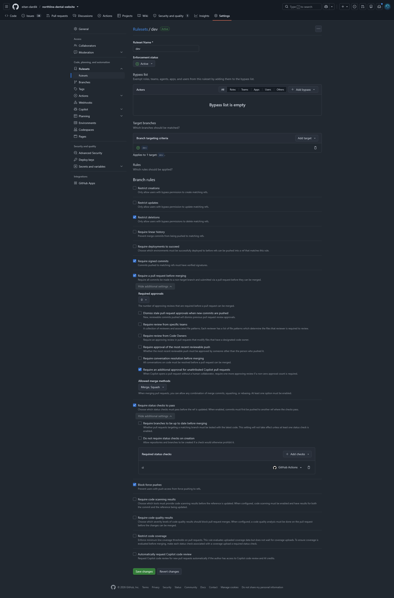
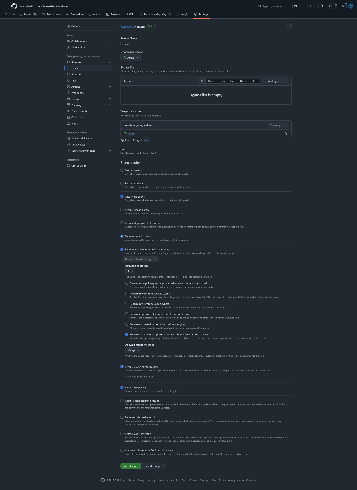
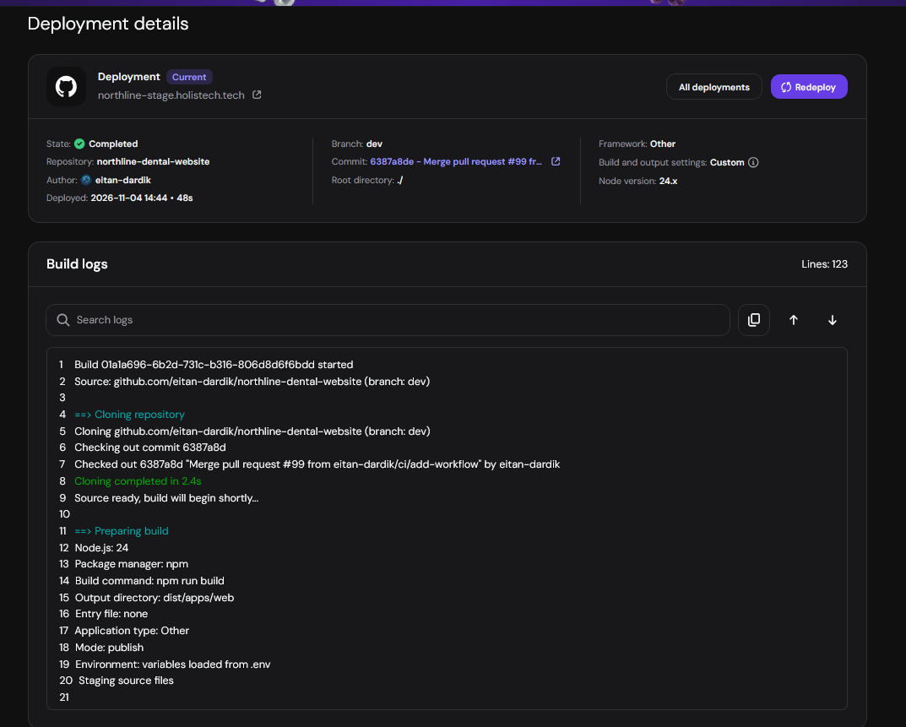
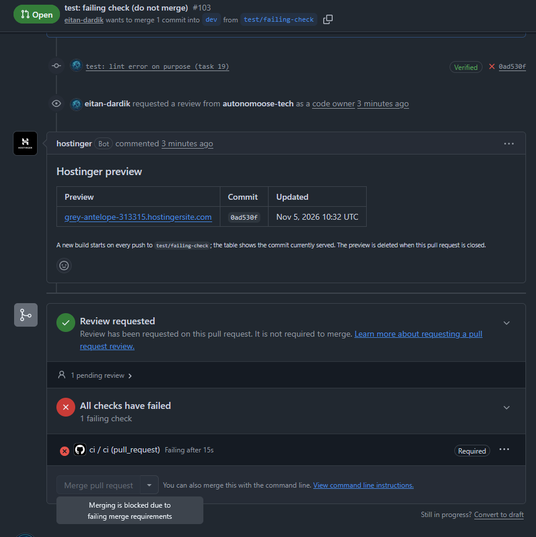
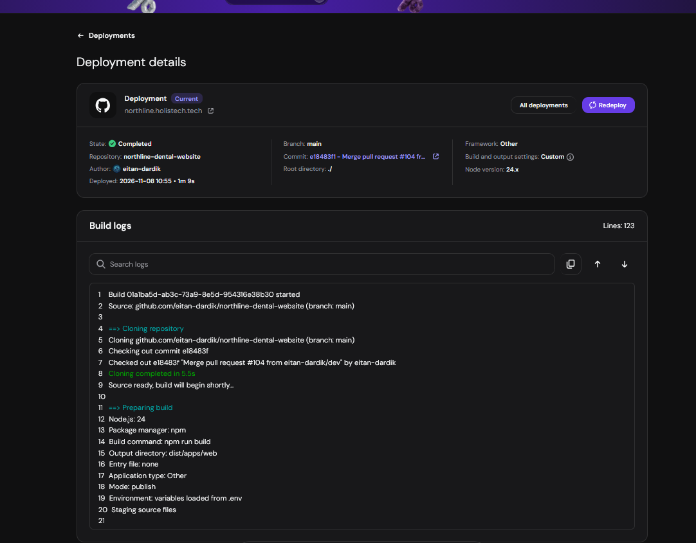

# Week 5 Evidence

| # | Item | Proof |
|---|---|---|
| 1 | Rules for dev and main, empty bypass lists | [Rulesets](#row-1-rulesets): img/12-dev-ruleset.png, img/14-main-ruleset.png, rulesets/dev.json, rulesets/main.json |
| 2 | Three refusals, word for word | [refusals.md](refusals.md): push to main, merge without approval, unsigned commit |
| 3 | Signed commit and CODEOWNERS | [Signed commit output](#row-3-signed-commit); CODEOWNERS on [main](https://github.com/eitan-dardik/northline-dental-website/blob/main/.github/CODEOWNERS) and [dev](https://github.com/eitan-dardik/northline-dental-website/blob/dev/.github/CODEOWNERS) |
| 4 | CI: workflow, a passing run, a blocked failing run, the staging build | [ci.yml](https://github.com/eitan-dardik/northline-dental-website/blob/dev/.github/workflows/ci.yml); [passing run](https://github.com/eitan-dardik/northline-dental-website/actions/runs/41830732177) on [PR #99](https://github.com/eitan-dardik/northline-dental-website/pull/99); [blocked failing run](https://github.com/eitan-dardik/northline-dental-website/actions/runs/42011499976) on [PR #103](https://github.com/eitan-dardik/northline-dental-website/pull/103); staging build and failing check: [see below](#row-4-ci) |
| 5 | Release v0.5.0 | [PR #104](https://github.com/eitan-dardik/northline-dental-website/pull/104) (opened Thu 13:44, approved Thu 16:44, merged Sun 10:54); signed tag [v0.5.0](https://github.com/eitan-dardik/northline-dental-website/releases/tag/v0.5.0) on `e18483f`; production from main: img/21-deployments.png; staging from dev: img/11-staging-deploy.png |
| 6 | RELEASE.md | [RELEASE.md on dev](https://github.com/eitan-dardik/northline-dental-website/blob/dev/RELEASE.md), merged in [PR #102](https://github.com/eitan-dardik/northline-dental-website/pull/102) |
| 7 | Incident 1 comment and Incident 2 times | Incident 1: [line comment](https://github.com/eitan-dardik/northline-dental-website/pull/100#discussion_r4469729593) and [signature comment](https://github.com/eitan-dardik/northline-dental-website/pull/100#issuecomment-6635211886) on [PR #100](https://github.com/eitan-dardik/northline-dental-website/pull/100); Incident 2: [rollback.md](rollback.md) (drill, 4 min 58 s) |
| 8 | Umami backup, upgrade and rollback | [umami.md](umami.md): backup restored (339 = 339); upgrade 3.4.0 → 3.4.1 down ~17 s, rollback down ~15 s, count 339 at every step; logs: [upgrade poll](logs/umami-upgrade-poll.log), [rollback poll](logs/umami-rollback-poll.log) |
| 9 | Decision brief, board, multiplier, retrospective | [decision.md](decision.md) (board, multiplier 0.40, retrospective inside) |
| 10 | Knowledge gate | course links; img/28-w3schools.png |


## Row 1: rulesets

Both rulesets are **active**, and both bypass lists are **empty**: the rules apply to everyone, the owner included.

| Rule | dev | main |
|---|---|---|
| Restrict deletions | On | On |
| Require signed commits | On | On |
| Require a pull request before merging | On, 0 approvals | On, 1 approval |
| Require review from Code Owners | Off | On |
| Dismiss stale approvals on new commits | Off | On (added after the CEO's review of #104) |
| Extra approval for unattributed Copilot PRs (GitHub default) | On (no effect at 0 approvals) | On (a Copilot-only PR needs 2 approvals) |
| Require status checks to pass: `ci` (GitHub Actions) | On | On |
| Block force pushes | On | On |
| Allowed merge methods | Merge, Squash | Merge only |

**dev:** 
Export: [rulesets/dev.json](rulesets/dev.json)

**main:** 
Export: [rulesets/main.json](rulesets/main.json)


## Row 3: signed commit

Commit 7ee68c8, checked with `git log --show-signature -1`:

```
commit 7ee68c841d1cb825265557131347477fa76b923a (HEAD -> evidence/w5)
Good "git" signature for 278788152+eitan-dardik@users.noreply.github.com with ED25519 key SHA256:Q87+2Z/LeO8XLnXULMLVfCcG9BnVvUsCnjOBhLhifQg
Author: Eitan <278788152+eitan-dardik@users.noreply.github.com>
Date:   Tue Nov 3 13:29:49 2026 +0200
```

Unsigned commits on dev but not on main (`git rev-list --count origin/main..origin/dev`): **0**


## Row 4: CI

**Staging build after merging PR #99** (Hostinger, branch dev, commit 6387a8d, Node 24.x, the same as `ci.yml`):



**Blocked failing run (task 19):** a lint error on purpose in [PR #103](https://github.com/eitan-dardik/northline-dental-website/pull/103). [`ci` failed](https://github.com/eitan-dardik/northline-dental-website/actions/runs/42011499976) (`no-undef`, `format.js` 40:38) and the merge was blocked. The commit is signed and dev needs no review, so `ci` alone blocked it.




## Row 5: release

**Production deploys from main:** release merge `e18483f` (PR #104), Completed 10:55, Node 24.x. Both sites answer 200.



**Staging deploys from dev:** see Row 4.