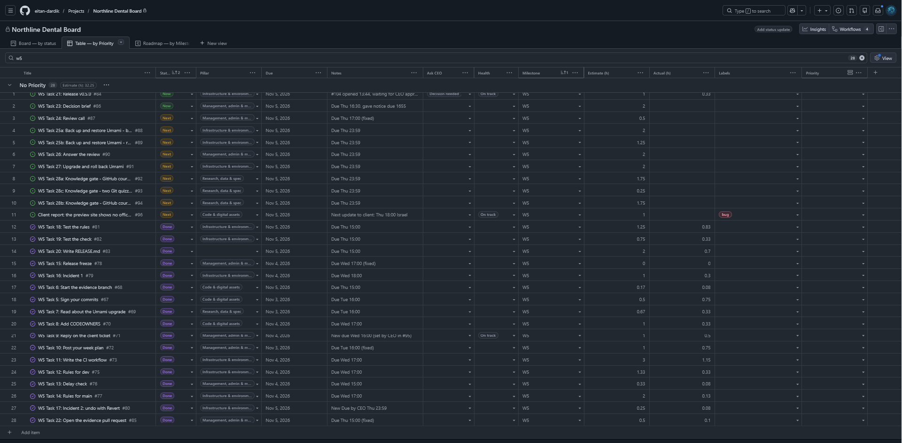

# Decision brief: how Northline's releases and fixes should work

**Decision: keep every change to `main` behind CI and the CEO's approval, and release to `main` only between 16:00 and 22:00 Israel time, when a fix can be approved quickly.**

## Two options

**A. Keep the gates as they are, and add a release window (16:00–22:00 Israel)**
- Pro: nothing reaches production without `ci` and a code owner approval. The rules apply to everyone.
- Pro: inside the window, the CEO (Toronto, 7 h behind) is working, so a fix can be approved within minutes.
- Con: a problem found in the Israel morning (08:30–16:00) can wait up to 7½ hours, while production stays broken.

**B. Keep the gates, and add a second code owner in the Israel time zone**
- Pro: a fix to production can be approved at any hour of my working day.
- Con: needs another trusted person with write access. Two people must know the routine.

## My numbers

| Measure | Result |
|---|---|
| Revert on dev (task 17 drill) | **4 min 58 s**, from the change live to staging fixed ([rollback.md](rollback.md)) |
| Approval wait on main (task 21) | Release [PR #104](https://github.com/eitan-dardik/northline-dental-website/pull/104) opened 13:44, approved 16:44: **3 h 0 min**. 13:44 Israel is 06:44 Toronto; the approval came 44 min after the CEO's workday started (09:00 Toronto) |

The Revert itself is fast (5 min). The waiting is the cost: on `main`, the same fix would also wait for approval, here 3 hours, about 4 times the 43-minute monthly allowance. Inside the release window, the CEO is working, so that wait shrinks to minutes.

## Recommendation

Option A now: release to `main` only between 16:00 and 22:00 Israel, as written in [RELEASE.md](https://github.com/eitan-dardik/northline-dental-website/blob/dev/RELEASE.md). Plan option B if Northline needs fixes outside that window.

**Decided (CEO, 9 Nov, #107):** for a critical fault outside the release window, I proposed three ways to get approval: an emergency phone call, a break-glass account, or a second approver ([my answer to review item 6](https://github.com/eitan-dardik/northline-dental-website/pull/107#issuecomment-6737608914)). The CEO chose **the emergency phone call**: I phone him, even outside his hours, for critical faults only; no bypass, no break-glass account. The list of critical faults and the steps until he approves are in [RELEASE.md](https://github.com/eitan-dardik/northline-dental-website/blob/dev/RELEASE.md#when-a-fix-to-production-waits-for-approval) ([#113](https://github.com/eitan-dardik/northline-dental-website/pull/113)).

## What I need from you

1. Agreement on the release window, 16:00–22:00 Israel.
2. A decision on option B: a second code owner, yes or no.
3. Approval of release PR #104.

---

## Board

## Multiplier

17 Done cards with an Actual (tasks 5–20 and 22): total actual **6.77 h** ÷ total estimated **16.75 h** = **0.40**

My estimates (already ×2.0) were too high: I finished in about 40% of the estimated time, so my personal factor is closer to 0.8 than 2.0. However, time spent learning between tasks is **not** always counted.

## Retrospective

- **Went well:** the rules blocked both bad PRs (#100 lint, #101 unsigned) without me changing anything.
- **Went badly:** "Require review from Code Owners" on main wasn't saved; CODEOWNERS added twice caused a conflict.
- **Took longest:** Task 11, CI workflow (estimate 3 h, actual 1.15 h).
- **I will change:** check what GitHub saved, not what the page showed: compare the export or `gh api` output with the requirements. And end every `git switch -c` with `origin/dev` or `origin/main`, so a new branch always starts from GitHub's latest version.
- **I need:** a decision on the release window and on a second code owner.