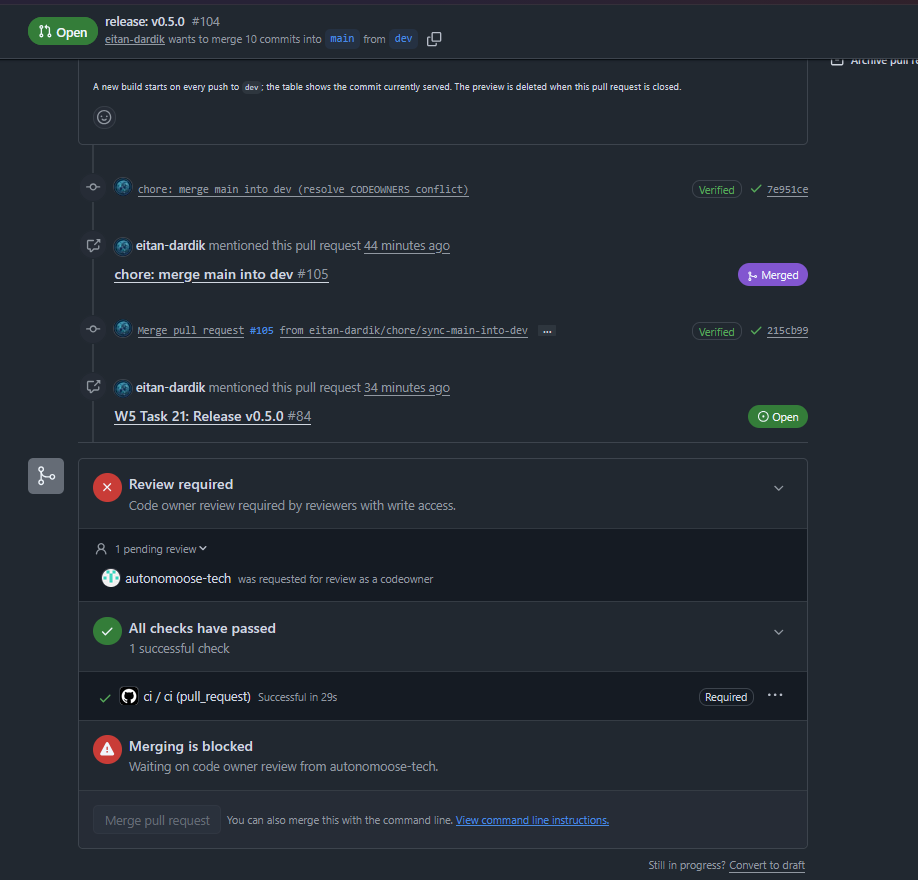
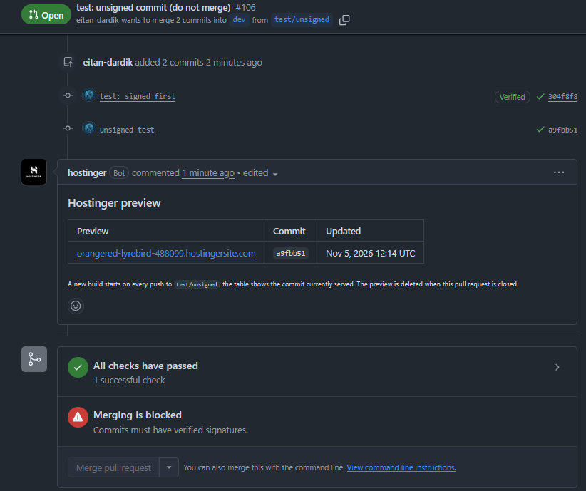

# Task 18: three refusals, word for word

Each test isolates one rule. Below each test: the commands I ran, the refusal, and what it means.

## 1. Push straight to main

The commit is **signed**, so only the pull request and `ci` rules are tested.

```bash
git switch main
git pull
git commit --allow-empty -m "test: direct push"
git push origin main
```

Refusal:

```
remote: error: GH013: Repository rule violations found for refs/heads/main.
remote: Review all repository rules at https://github.com/eitan-dardik/northline-dental-website/rules?ref=refs%2Fheads%2Fmain
remote:
remote: - Changes must be made through a pull request.
remote:
remote: - Required status check "ci" is expected.
remote:
To github.com:eitan-dardik/northline-dental-website.git
 ! [remote rejected] main -> main (push declined due to repository rule violations)
error: failed to push some refs to 'github.com:eitan-dardik/northline-dental-website.git'
```

What the refusal means:

- `Changes must be made through a pull request.`: the main ruleset only accepts changes that come through a pull request. A direct push skips the pull request, so GitHub refused it.
- `Required status check "ci" is expected.`: `ci` never ran on this commit. The workflow only runs on pull requests (`on: pull_request`), so a direct push has no `ci` result, and main requires one.
- `[remote rejected] … push declined`: GitHub refused the whole push. The commit existed only on my PC and never reached main.

The commit was signed, so the signature rule is not part of this refusal. I'm the repository owner and was still refused, because the bypass list is empty.

Clean-up (removes the test commit from my local main):

```bash
git reset --hard origin/main
git log --oneline -1
```

```
37cd687 (HEAD -> main, origin/main, origin/HEAD) Merge pull request #98 from eitan-dardik/chore/codeowners-main
```

## 2. Merge a pull request into main without approval

Release PR [#104](https://github.com/eitan-dardik/northline-dental-website/pull/104), with `ci` passing and no CEO approval yet:

```bash
gh pr merge 104 --merge
```

Refusal:

```
X Pull request eitan-dardik/northline-dental-website#104 is not mergeable: the base branch policy prohibits the merge.
To have the pull request merged after all the requirements have been met, add the `--auto` flag.
To use administrator privileges to immediately merge the pull request, add the `--admin` flag.
```

On the PR page:

```
Merging is blocked
Waiting on code owner review from autonomoose-tech.
```



What the refusal means: `the base branch policy prohibits the merge` means the main ruleset blocks it. The PR page gives the exact reason: the code owner (the CEO) hasn't approved. `ci` passes and all commits are signed, so the missing approval is the only reason.

PR #104 stays open, because it is the real release, waiting for approval.

## 3. Unsigned commit on a branch with an open pull request

A test branch from dev, a signed commit, and a PR:

```bash
git fetch origin
git switch -c test/unsigned origin/dev
git commit --allow-empty -m "test: signed first"
git push -u origin test/unsigned
gh pr create --base dev --head test/unsigned --title "test: unsigned commit (do not merge)" --body "W5 task 18, test 3: an unsigned commit on an open PR. Will be closed, not merged."
```

Then an unsigned commit (signing turned off for this one command only), pushed:

```bash
git -c commit.gpgsign=false commit --allow-empty -m "unsigned test"
git push
```

The push itself worked: the ruleset protects `dev`, not the test branch. The refusal is on PR [#106](https://github.com/eitan-dardik/northline-dental-website/pull/106).

On the PR page, with `ci` passing:

```
Merging is blocked
Commits must have verified signatures.
```



From the terminal:

```bash
gh pr merge 106 --merge
```

```
X Pull request eitan-dardik/northline-dental-website#106 is not mergeable: the base branch policy prohibits the merge.
```

What the refusal means: one unsigned commit blocks the whole pull request, even with a signed commit next to it and `ci` passing. The terminal message is the same as in test 2; only the PR page shows which rule blocked it.

Which commit is unsigned, from the GitHub API:

```bash
gh api repos/eitan-dardik/northline-dental-website/pulls/106/commits --jq '.[] | {sha: .sha[0:7], verified: .commit.verification.verified, reason: .commit.verification.reason}'
```

```json
{ "reason": "valid",    "sha": "304f8f8", "verified": true  }
{ "reason": "unsigned", "sha": "a9fbb51", "verified": false }
```

Clean-up:

```bash
gh pr close 106 --delete-branch --comment "Task 18 test 3 done: the unsigned commit a9fbb51 blocked the merge. Closed without merging."
git switch evidence/w5
git branch -D test/unsigned
```