# Week 7 Evidence

| # | Item | Proof |
|---|---|---|
| 1 | Incident review | [incident-review.md](incident-review.md) (the review of Tue 17 Nov; actions [#184](https://github.com/eitan-dardik/northline-dental-website/issues/184), [#182](https://github.com/eitan-dardik/northline-dental-website/issues/182), [#183](https://github.com/eitan-dardik/northline-dental-website/issues/183)); the agenda message: [see below](#row-1-incident-review) (sent Sun 15 Nov, 21:30) |
| 2 | Board and week-start comment | [img/23-board.png](img/23-board.png) (task 27, Tue 17 Nov, before 16:00); [the comment on #114](https://github.com/eitan-dardik/northline-dental-website/issues/114#issuecomment-6945254828) |
| 3 | Ops log | To do: [#140](https://github.com/eitan-dardik/northline-dental-website/issues/140), one comment for each day Mon–Thu |
| 4 | Kit configured, staging, CI | Kit as it came: [PR #150](https://github.com/eitan-dardik/northline-dental-website/pull/150); configured: [22b66db](https://github.com/eitan-dardik/northline-dental-website/commit/22b66db) ([#152](https://github.com/eitan-dardik/northline-dental-website/issues/152)), [diff against the kit](https://github.com/eitan-dardik/northline-dental-website/compare/5b699eb...22b66db); decision record line: [PR #153](https://github.com/eitan-dardik/northline-dental-website/pull/153); staging and CI: [PR #155](https://github.com/eitan-dardik/northline-dental-website/pull/155), [green CI run on `event`](https://github.com/eitan-dardik/northline-dental-website/actions/runs/43943229108); the main site's deploy unchanged; details: [see below](#row-4-kit-configured-staging-ci) |
| 5 | Releases v0.1.0, v0.2.0, v0.3.0, v1.0.0 | [event-v0.1.0](https://github.com/eitan-dardik/northline-dental-website/releases/tag/event-v0.1.0) (Mon 16 Nov, on `76af798`); [event-v0.2.0](https://github.com/eitan-dardik/northline-dental-website/releases/tag/event-v0.2.0) (Wed 18 Nov, on `b2ea3df`); [event-v0.3.0](https://github.com/eitan-dardik/northline-dental-website/releases/tag/event-v0.3.0) (Wed 18 Nov, on `9dd0aec`). To do: event-v1.0.0 |
| 6 | Migration, rules proof, phone read-back | [the migration](https://github.com/eitan-dardik/northline-dental-website/blob/dev/supabase/migrations/20261117191400_event_registrations.sql) (PR [#185](https://github.com/eitan-dardik/northline-dental-website/pull/185)); insert `201` / read `401`; the row: 22:49:40 Israel, `utm_source invitation`; details: [see below](#row-6-migration-rules-proof-phone-read-back) |
| 7 | Confirmation, confirm link and deliverability | the confirmation for `+og003`: accepted 12 s after registering, `verified_at` 10:16:00 Israel; details: [see below](#row-7-confirmation-confirm-link-and-deliverability). [email-check.md](email-check.md) (task 35: Gmail and Outlook, both Inbox, SPF/DKIM/DMARC pass). To do: the `+og006` reminder to confirm (due after 00:05 Thu) |
| 8 | Umami events, UTM links, QR | every event from laptop and phone, no token or personal data (0), the confirm view without `t=`; all four links in Umami (`invitation`, `reminder`, `poster`, `website`); the poster QR to Denise at 12:53 ([#114](https://github.com/eitan-dardik/northline-dental-website/issues/114#issuecomment-6976434725)), [img/34-qr.png](img/34-qr.png); the banner ([PR #192](https://github.com/eitan-dardik/northline-dental-website/pull/192)); details: [see below](#row-8-umami-events-utm-links-qr) |
| 9 | Desk rehearsal | Wed 18 Nov, 17:54–17:57: check-ins in 22 s and 35 s, a walk-up in 34 s; the page's count = query 3 (11 registered, 3 arrived, 1 walk-up); the two desk lines; details: [see below](#row-9-desk-rehearsal) |
| 10 | Screenshots and Denise's approval | six screenshots on [#114, Wed 18 Nov 18:33](https://github.com/eitan-dardik/northline-dental-website/issues/114#issuecomment-6984843417), asking "Can this go live on Thursday?". To do: her answer (by Thu 8:00 her time) |
| 11 | Run of show draft | To do: link to RUN-OF-SHOW.md |
| 12 | Restore drill and decision brief | To do: restore.md; decision-brief.md |
| 13 | Production release | To do: times merged, live, checked |
| 14 | Invitations and status email | To do: invitations.md; status-email.md |

**Moved from Week 6** (W6 scorecard on feedback #7, 15 Nov: task 16 to Tue 17, task 14 to Wed 18, task 18 to Thu 19; task 16's time confirmed by the CEO's email of 15 Nov, 23:09: Tue 17, 23:59):

| Task | Item | Proof |
|---|---|---|
| 16 | Invite list check | [LIST-CHECK.md](https://github.com/eitan-dardik/northline-dental-website/blob/dev/docs/event/LIST-CHECK.md) (PR [#180](https://github.com/eitan-dardik/northline-dental-website/pull/180): the counts, each problem row and what I do with it, 103 reachable contacts; no list in the repository); [the reply on #114](https://github.com/eitan-dardik/northline-dental-website/issues/114#issuecomment-6950048179); updated Wed 18 with Denise's fixes: 108 reachable ([PR #188](https://github.com/eitan-dardik/northline-dental-website/pull/188)) |
| 14 | Contact form limits | To do: the PR into `dev` with each rule's refused insert and its error code; one refused insert repeated on staging; both names in other languages accepted; #35 and #36 closed with the proof. Moved again by the CEO to Mon 23 Nov, 23:59 ([#128](https://github.com/eitan-dardik/northline-dental-website/issues/128)) |
| 18 | Week 4 evidence pack | [PR #148](https://github.com/eitan-dardik/northline-dental-website/pull/148) |

**Actual (h)** is filled in on every finished card on the [Open Morning board](https://github.com/users/eitan-dardik/projects/7).

## Row 1: incident review

**The agenda** was due Sun 15 Nov, 20:00 Israel. I sent it by Telegram at **21:30**, 1 h 30 min late, and said so on [#149](https://github.com/eitan-dardik/northline-dental-website/issues/149).

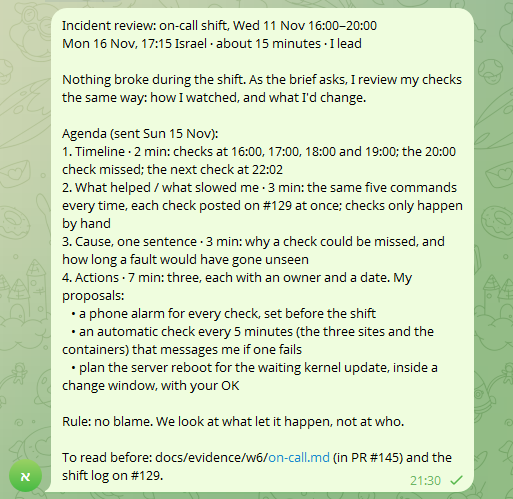

## Row 4: kit configured, staging, CI

**The kit as it came:** [PR #150](https://github.com/eitan-dardik/northline-dental-website/pull/150), merged without changes (5b699eb).

**My changes, in a second commit:** [22b66db](https://github.com/eitan-dardik/northline-dental-website/commit/22b66db). Compared with the kit, only `config.js` and `assets/brand.css` changed, plus the five font files that `brand.css` loads, which the kit README (step 2) allows: [the diff against the kit](https://github.com/eitan-dardik/northline-dental-website/compare/5b699eb...22b66db).

| What | Changed to | Why |
|---|---|---|
| Event details | from PLAN.md and Denise's email (forwarded by the CEO on 15 Nov): the offer, "nothing to bring" | Denise's answers |
| Privacy line | names everything the form keeps (name, email, phone if given, the two answers), the offer email and the survey | the kit README asks for the survey; CAPTURE.md asks for every field |
| Logo | hero image; the header shows the name only | the kit's header logo is small; the hero shows it at a readable size |
| `registration` | `'soon'` | the form opens on Tue 17 Nov (task 33) |
| `--brand-ink` | `#2b2724`, darker than the site's `#6b6560` | the event-day notice failed contrast: accessibility 96, `#phase-notice` 2.03:1 ([before](lighthouse/29-before.json)); after the fix, accessibility 100 ([after](lighthouse/29-after.json)). Lighthouse, mobile, Incognito, on localhost with the event set to "now" for the test |
| Fonts | Inter and Fraunces, self-hosted woff2 | the same fonts as the main site, without a call to an outside server |

**Checked:** with `npx serve .` on my laptop, desktop and mobile view.

**Answered on [#152](https://github.com/eitan-dardik/northline-dental-website/issues/152) (Tue 17 Nov):** the two mobile CSS lines were a defect in the kit; the CEO fixed it on the kit side ([PR #181](https://github.com/eitan-dardik/northline-dental-website/pull/181), merged into `event`), so my diff against the kit stays `config.js` and `brand.css`. The office question: no; the booking page asks it after the event.

**Decision record:** the line `Event branch: event` (asked on feedback #8), merged in [PR #153](https://github.com/eitan-dardik/northline-dental-website/pull/153) with CI green.

**Staging (task 30):** [PR #155](https://github.com/eitan-dardik/northline-dental-website/pull/155) into `event`: the staging block in `config.js` (the existing staging API and publishable key, as in the decision record), a CI job for `event` and `event-main`, and a minimal `package.json`, because Hostinger's Git deployment stopped without one (first try, 21:31). `event` → `event-stage` by Hostinger's Git deployment, with no build: `76af798` Completed at 21:49.

| Check | Result |
|---|---|
| The event on my phone | over 4G, 21:51–21:53: the event, the timetable, the offer and "Registration opens soon"; HTTPS valid; no sideways scroll |
| CI green on `event` | on PR #155 and on [the push to `event`](https://github.com/eitan-dardik/northline-dental-website/actions/runs/43943229108) (`76af798`) |
| The main site's deploy unchanged | production still on `e18483f` (8 Nov, 10:54); northline-stage only deployed `dev` merges (#153 at 17:25, #154 at 18:18), all before the event work |

**The main site's deploys** (hPanel, Mon 16 Nov, after the event deploy): production's newest is still `e18483f1` from 8 Nov; northline-stage's newest are the `dev` merges of #154 and #153.

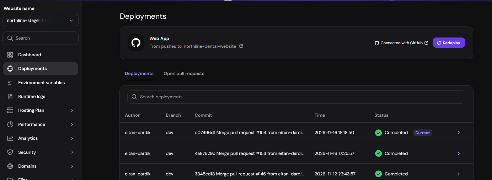 

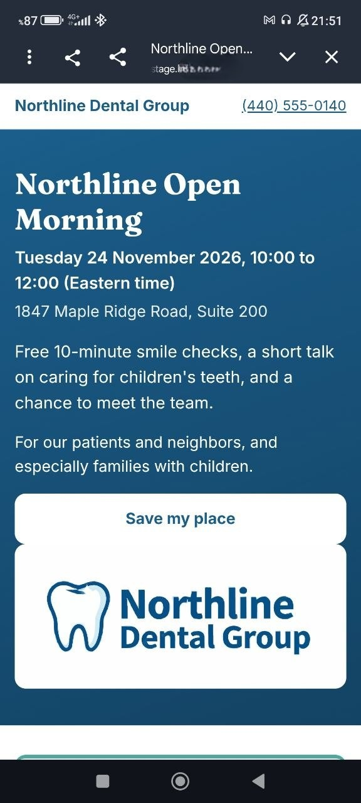 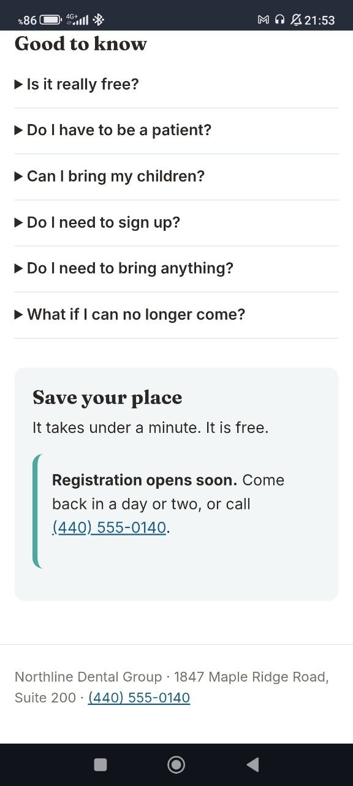

## Row 6: migration, rules proof, phone read-back

**The migration (task 32, [#163](https://github.com/eitan-dardik/northline-dental-website/issues/163)):** the kit's `supabase/migration.sql`, copied unchanged (`diff` against the kit prints nothing) as `20261117191400_event_registrations.sql`, by [PR #185](https://github.com/eitan-dardik/northline-dental-website/pull/185) into `dev`. Applied to staging from `dev` with the CLI, through the SSH tunnel, Tue 17 Nov. `dev` has every migration staging has (task 14's moved to Wed 18), so no merge into `event` was needed.

```
$ npx supabase migration list --db-url "$DB"
   Local            | Remote           | Time (UTC)
  ------------------|------------------|-----------------------
   `20260928105035` | `20260928105035` | `2026-09-28 10:50:35`
   `20260928105129` | `20260928105129` | `2026-09-28 10:51:29`
   `20261020101326` | `20261020101326` | `2026-10-20 10:13:26`
   `20261101092708` | `20261101092708` | `2026-11-01 09:27:08`
   `20261117191400` | ` `              | `2026-11-17 19:14:00`

$ npx supabase db push --db-url "$DB" --dry-run
DRY RUN: migrations will *not* be pushed to the database.
Would push these migrations:
 • 20261117191400_event_registrations.sql

$ npx supabase db push --db-url "$DB"
Applying migration 20261117191400_event_registrations.sql...
Finished supabase db push.

$ npx supabase migration list --db-url "$DB"
   Local            | Remote           | Time (UTC)
  ------------------|------------------|-----------------------
   `20260928105035` | `20260928105035` | `2026-09-28 10:50:35`
   `20260928105129` | `20260928105129` | `2026-09-28 10:51:29`
   `20261020101326` | `20261020101326` | `2026-10-20 10:13:26`
   `20261101092708` | `20261101092708` | `2026-11-01 09:27:08`
   `20261117191400` | `20261117191400` | `2026-11-17 19:14:00`
```

`$DB` is the tunnel address with `?sslmode=disable`: the connection is already encrypted by SSH, and the database behind it has no TLS of its own.

**The rules, through the public API with the publishable key** (Tue 17 Nov, 21:52 Israel; the kit README's two `curl`s, without the `Authorization` header for an `sb_publishable_` key):

```
$ curl … -X POST "https://<staging API>/rest/v1/registrations" …   # insert
201
$ curl … "https://<staging API>/rest/v1/registrations?select=*"    # read
{"code":"42501","details":null,"hint":"…","message":"permission denied for table registrations"}
401
```

**Staging desk code:** set at 22:15 with query 1 of the kit's `queries.sql`, the code passed in a variable so it isn't in the server's history; stored only as a hash. The code is in my password manager, never in the repository. (Set again on Wed 18 with a length check, see row 9.)

**The phone test (task 33, [#164](https://github.com/eitan-dardik/northline-dental-website/issues/164)):** after [PR #186](https://github.com/eitan-dardik/northline-dental-website/pull/186) (`registration: 'open'`, `maxGuests: 7`), on staging, Chrome private tab, mobile data, Tue 17 Nov.

| Check | Result |
|---|---|
| Registered from the invitation link, as `…+og1711@…`, 2 people (`+og001` was used for the W6 lead test) | 22:49 on the phone; "You are registered" |
| Read back (query 2) | stored **20:49:40 UTC = 22:49:40 Israel**, `guests 2`, `utm_source invitation`, `utm_medium email`, `utm_campaign 2026-11-open-morning`; `verified_at` empty (task 34) |
| The same email again | the same "You are registered"; still one `+og1711` row |
| Airplane mode, as `…+og171102@…`, 3 people, 22:59 | "We could not save this just now. Please call (440) 555-0140 and we will do it for you.", under the button; no row stored |
| The CEO's kit fix [#181](https://github.com/eitan-dardik/northline-dental-website/pull/181) | the timetable time stays on one line; space between "Save my place" and the image |
| Found | the phone's normal tab kept the old page ("Registration opens soon") from its cache; a private tab showed the new one |

**The read-back after both tests** (23:21 Israel, 21:21:48 UTC, `date` on top): one `+og1711` row, stored at 20:49:40 UTC with `utm_source invitation`, and no `+og171102` row.

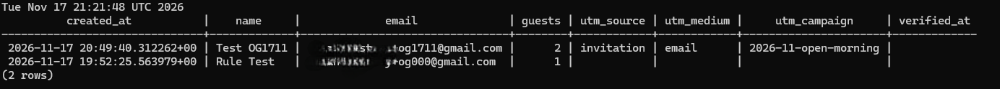

**On the phone:**

| 1. Registered (22:49) | 2. Airplane mode (22:59) | 3. #181: the time on one line | 4. #181: space above the image |
|---|---|---|---|
|  | 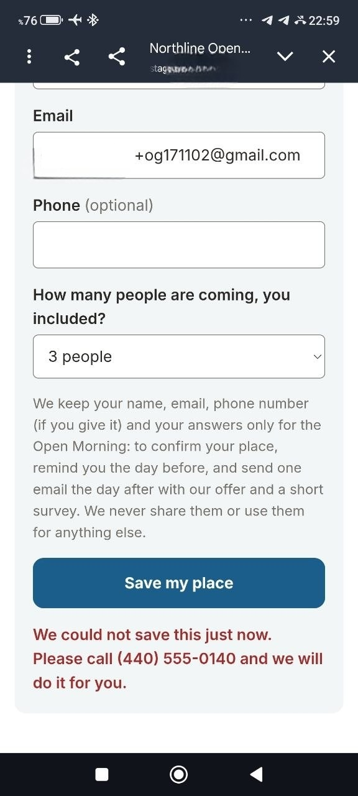 | 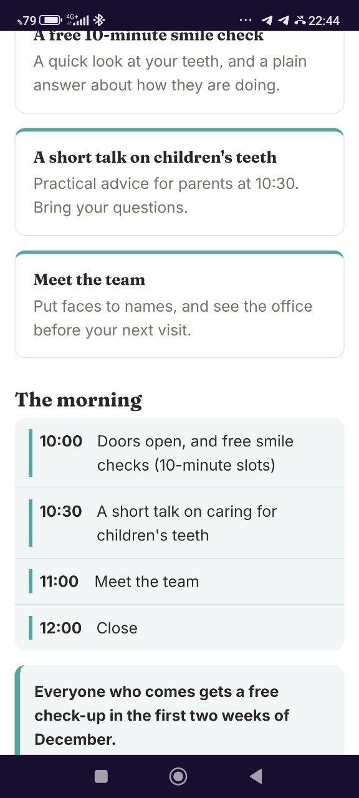 | 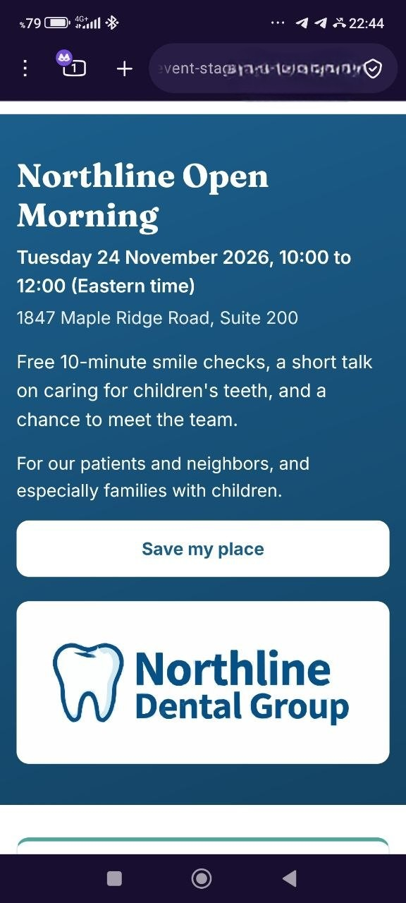 |
| "You are registered" for `…+og1711@…`, 2 people | "We could not save this just now…" with the phone number; no row stored | "10:00" no longer breaks onto two lines | space between "Save my place" and the logo |


## Row 7: confirmation, confirm link and deliverability

**The mailer (task 34, [#165](https://github.com/eitan-dardik/northline-dental-website/issues/165)):** [PR #187](https://github.com/eitan-dardik/northline-dental-website/pull/187) into `dev`. It sends the confirmation to every page registration without one (the kit's query 6) and one reminder to confirm 24 h later if the link was never pressed (query 8), with `registration_emails` as its "already sent" table, claim-first like `lead_emails`. It logs the mail server's reply for each email. Event emails only where `mailer.env` has `EVENT_URL`: on staging since Tue 17 Nov, 23:5x; production on Thursday. Deployed on staging only (staging and production build from the same clone; production not rebuilt).

The mailer's log when it started (Tue 17 Nov; ids only, no personal data):

```
mailer started; event emails on
sent: registration f3ecf737-… confirmation: 250 2.0.0 OK ids=540cdeb2… (accepted 1, rejected 0)
sent: registration 602b54f3-… confirmation: 250 2.0.0 OK ids=546866b7… (accepted 1, rejected 0)
```

| Check (`+og003`, from my phone) | Result |
|---|---|
| Registered | 21:57:20 UTC (Tue 23:57:20 Israel) |
| Confirmation accepted by the mail server (`sent_at`) | 21:57:32 UTC: **12 s** after registering; arrived in Gmail the same minute |
| The email | Denise's approved text (the "Confirmation" email in [EMAILS.md](https://github.com/eitan-dardik/northline-dental-website/blob/dev/docs/event/EMAILS.md)), the link as a button |
| Pressed "Confirm my place" | Wed 18 Nov, 10:16: "Your email is confirmed"; `verified_at` **08:16:00 UTC** |
| The address after the page loaded | `https://<event staging>/confirm/?utm_source=confirmation&utm_medium=email&utm_campaign=2026-11-open-morning`: **no `t=`** |
| Pressed it again | 10:17: "Already confirmed"; `verified_at` unchanged |
| `registration_emails` | one `confirmation` row for each of the 4 registrations |
| `+og006` | registered Wed 00:05 Israel, link not pressed: its reminder to confirm is due after 00:05 Thu |
| Found | the first two test emails, sent in the same second, arrived about 2 minutes apart in Gmail; the server accepted both at once (`250 OK`), so the delay was after my server |


| 1. The email (23:57) | 2. Confirmed (10:16) | 3. Pressed again (10:17) |
|---|---|---|
| 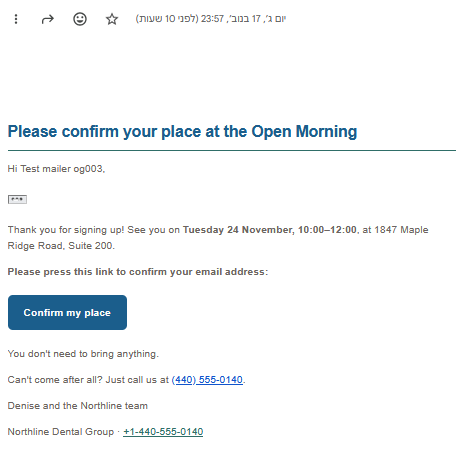 |  |  |


## Row 8: Umami events, UTM links, QR

**Umami (task 37, [#161](https://github.com/eitan-dardik/northline-dental-website/issues/161)):** two new Umami websites, `Open Morning – staging` and `Open Morning – production`, so test visits never count in production; their ids in `config.js` by [PR #190](https://github.com/eitan-dardik/northline-dental-website/pull/190) (the rest of the production block stays `REPLACE` until the release PR on Thursday). Umami counts staging since Wed 18 Nov, 13:06 Israel.

Everything Umami stored for staging from 13:00, read on the server from Umami's database (Israel time; `data` = the event's properties):

```
  israel  |    what     | url_path  |                          url_query                                       | device | browser |            data
----------+-------------+-----------+--------------------------------------------------------------------------+--------+---------+-------------------------------------
 13:06:45 | view        | /         |                                                                          | laptop | chrome  |
 13:09:25 | view        | /         | utm_campaign=7309-51-rNCg-CnppSUi&utm_medium=IL&utm_source=aDqCFY        | mobile | chrome  |
 13:25:12 | view        | /         | utm_source=invitation&utm_medium=email&utm_campaign=2026-11-open-morning | laptop | chrome  |
 13:25:33 | view        | /         | utm_source=reminder&utm_medium=email&utm_campaign=2026-11-open-morning   | laptop | firefox |
 13:29:32 | view        | /         | utm_source=invitation&utm_medium=email&utm_campaign=2026-11-open-morning | mobile | chrome  |
 13:29:47 | form_start  | /         | utm_source=invitation&…                                                  | mobile | chrome  | form=event_registration
 13:30:19 | form_submit | /         | utm_source=invitation&…                                                  | mobile | chrome  | form=event_registration, channel=form
 13:46:45 | view        | /         | utm_source=poster&utm_medium=qr&utm_campaign=2026-11-open-morning        | mobile | chrome  |
 13:46:48 | cta_click   | /         | utm_source=poster&…                                                      | mobile | chrome  | location=hero, label=register
 13:47:02 | form_start  | /         | utm_source=poster&…                                                      | mobile | chrome  | form=event_registration
 13:47:02 | form_error  | /         | utm_source=poster&…                                                      | mobile | chrome  | form=event_registration, reason=validation
 13:48:08 | form_submit | /         | utm_source=poster&…                                                      | mobile | chrome  | form=event_registration, channel=form
 13:48:21 | cta_click   | /         | utm_source=poster&…                                                      | mobile | chrome  | location=event, label=calendar
 13:48:29 | cta_click   | /         | utm_source=poster&…                                                      | mobile | chrome  | location=registered, label=call
 14:05:45 | view        | /confirm/ | utm_source=confirmation&utm_medium=email&utm_campaign=2026-11-open-morning | laptop | firefox |
 14:05:45 | form_submit | /confirm/ | utm_source=confirmation&…                                                | laptop | firefox | form=event_verification
```

| Check (workbook task 37) | Result |
|---|---|
| Every event, from laptop and phone | the phone (13:46–13:48, from the poster QR): page view, `cta_click` (register, calendar, call), `form_start`, `form_error`, `form_submit`. The laptop: page views, `form_start` and `form_submit` (13:29–13:30, in the browser's phone view), the confirm page and `event_verification` (14:05) |
| No personal data or token in any event | no name, email or phone in any column or property; views with `t=` or `@` in their address: **0** (all of staging's Umami data) |
| The confirm link's page view shows no `t=` | the link I pressed had `confirm/?t=<token>&utm_source=confirmation…`; Umami stored `/confirm/` with `utm_source=confirmation&utm_medium=email&utm_campaign=…` only: the page removes the token before Umami loads |
| `form_submit` count against the rows, from 13:00 | Umami **2**, `registrations` **4**. The 2 missing (`og005`, 13:10, and `og005b`, 13:41) came from my phone's Chrome while it still had an old `config.js` without the Umami id (see below). After clearing the phone's site data, `og005c` (13:48) arrived with every event. The database is the real count, as MEASURE.md says |

```
$ (Umami)  … where url_query ~ '(^|&)t=' or url_query ilike '%@%'
 views_with_a_token
--------------------
                  0
$ (Umami)  form_submit with form = event_registration, since 13:00     →  2
$ (staging) registrations from the page since 13:00                    →  4
```

**Found:**

- **Hostinger lets browsers keep the event files for 7 days** (`cache-control: public, max-age=604800` on `config.js`). A browser that opened the page before keeps the old `config.js`: on Tue 17 it showed "Registration opens soon"; on Wed 18 my phone's Chrome, and the Gmail app's own browser, still had a `config.js` from before Umami was connected. So `og005` and `og005b` registered (and `og005b` confirmed), but Umami got nothing from them, and neither confirm pressed in the Gmail app (13:43, 13:49) reached Umami. After clearing the phone's site data, everything arrived (13:46–13:48), and the confirm from a clean browser too (14:05). Raised with the CEO for Thursday ([#191](https://github.com/eitan-dardik/northline-dental-website/issues/191)).
- **Google Lens adds a view of its own.** Scanning the QR with the phone's camera (Lens), Umami got one extra view at 13:09 that wasn't mine: from another city, 0 seconds, no events, with Google's own tags (`aDqCFY`, `IL`) instead of the poster's. Lens fetches a preview of the page on Google's side before it opens Chrome. So Umami's poster **views** can include such previews; the poster **registrations** in the database (query 4) are the exact count.

**The links and the QR (task 38, [#162](https://github.com/eitan-dardik/northline-dental-website/issues/162)):** the four links from MEASURE.md, with the event's production address.

- **The poster QR** (`poster-qr.png` / `.svg`, made with `npx qrcode -e H` from the poster link): sent to Denise on [#114](https://github.com/eitan-dardik/northline-dental-website/issues/114#issuecomment-6976434725) at **12:53**, before her poster prints.
- **The test:** a second QR from the same link with the staging address, scanned from about 1 m: the page opened with `utm_source=poster&utm_medium=qr`, and the registrations were stored under `poster`.
- **In Umami:** `invitation`, `reminder` and `poster` (table above), and `website` from the banner (below).
- **The banner** ([PR #192](https://github.com/eitan-dardik/northline-dental-website/pull/192)): one line under the main site's menu, on every page: "Open Morning, Tue 24 Nov: free smile checks. Register →", linking to the event page with the website tags. Its address comes from a build setting, `VITE_EVENT_URL`, set only on the staging site for now; production gets it after event-v1.0.0. Hidden once the event starts. Lighthouse (mobile, localhost): accessibility 100. Clicked on staging, Wed 18 Nov:

```
  israel  | url_path |                               url_query                                | utm_source
----------+----------+------------------------------------------------------------------------+------------
 17:37:20 | /        | utm_source=website&utm_medium=banner&utm_campaign=2026-11-open-morning | website
```

```
$ query 4 (staging)
   source   | registered | came
------------+------------+------
 invitation |          7 |    0
 poster     |          3 |    0
 (no tag)   |          1 |    0
```

| The poster QR sent to Denise | The banner on Northline's staging site |
|---|---|
| 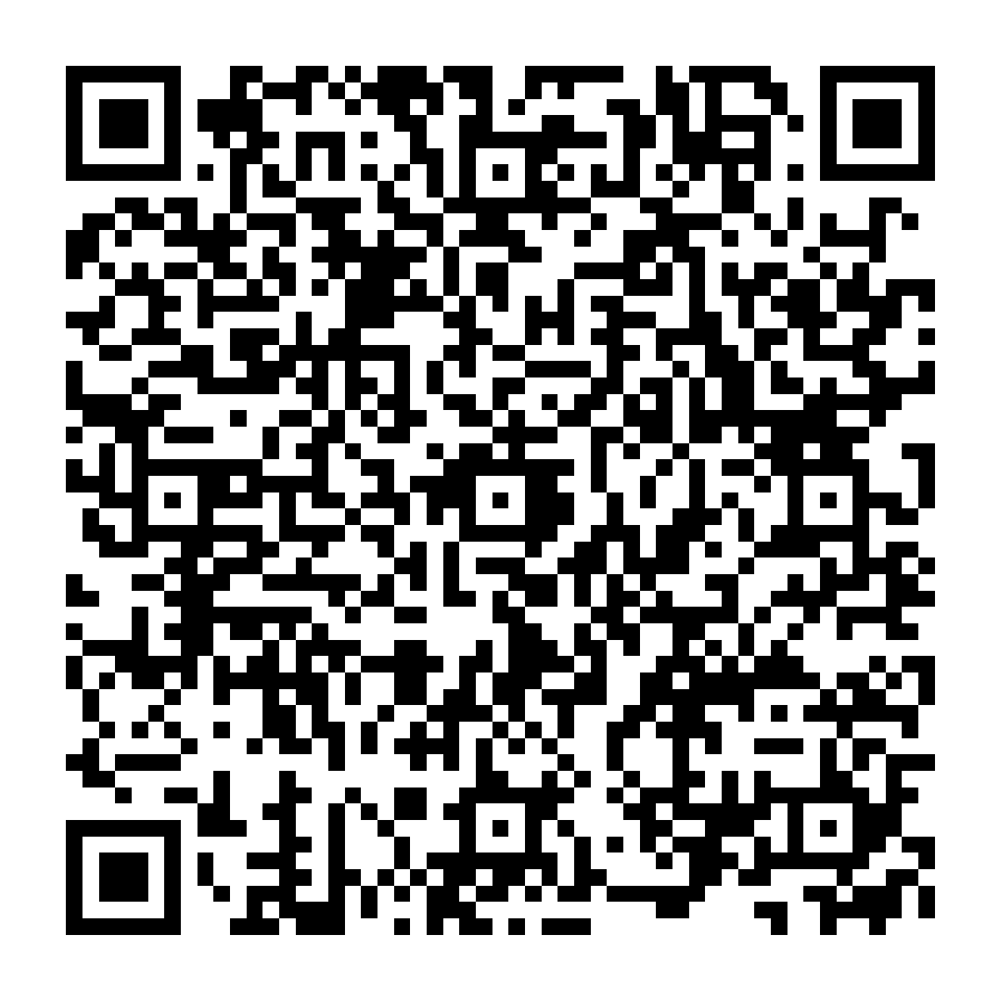 | 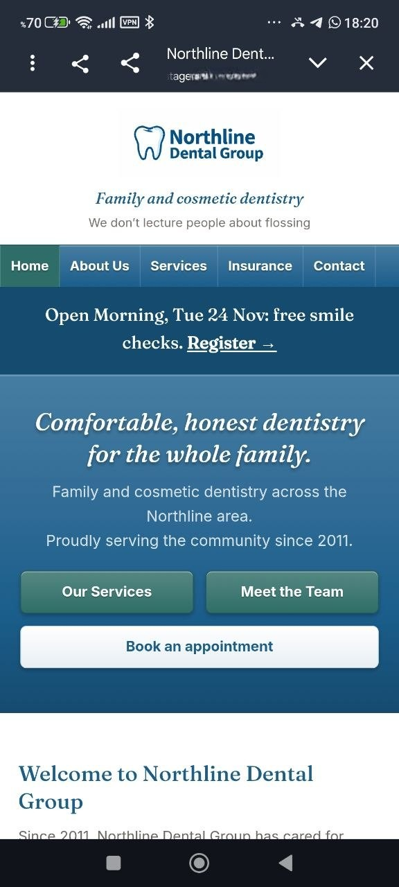 |


## Row 9: desk rehearsal

**Task 39 ([#168](https://github.com/eitan-dardik/northline-dental-website/issues/168)),** on staging, from my phone, Wed 18 Nov.

| Check | Result |
|---|---|
| The printed list (query 5) | 11 guests, sorted by name, with email and group size; unconfirmed guests included. Looked at on the server, then deleted (`rm`) |
| Guest 1, from the list | checked in in **22 s**: "Checked in: Test." |
| Guest 2, a group of 2 | **35 s**: "Checked in: Test. Group of 2." Over the 30 s target: typing a long email on a phone keyboard. On the day the desk types from the printed list, on a tablet or laptop if they have one |
| A walk-up (no email, new patient) | **34 s**, counted |
| The page's count against query 3 | "3 of 11 registered · 1 walk-up" = registered 11, arrived 3, walk-ups 1 |
| Found | the desk code set on Tue didn't match my password manager (likely a paste error into `read -rs`, which hides what's pasted). Set again with a length check (17 characters); the same check for production on Thursday |

```
$ query 3 (staging)
 registered | confirmed | arrived | walk_ups
------------+-----------+---------+----------
         11 |         4 |       3 |        1
```

**The two desk lines, for Denise's team:**

1. **A guest on the list:** find their name on the printed list, type their email exactly as printed into "The guest's email", and press **Check in**. The page says "Checked in" with their first name and group size; tick them on the list. Not on the list: add them as a walk-up (name, new or existing patient, how many).
2. **If the page stops working** (no internet, or "The desk code is not right"): carry on with the printed list. Tick each guest who arrives and write walk-ups at the bottom; nobody waits. Tell Eitan; the list is entered afterwards.

| The printed list (emails masked) | Guest 1 (22 s) | Guest 2 (35 s) | The count |
|---|---|---|---|
| 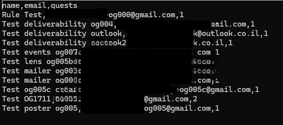 | 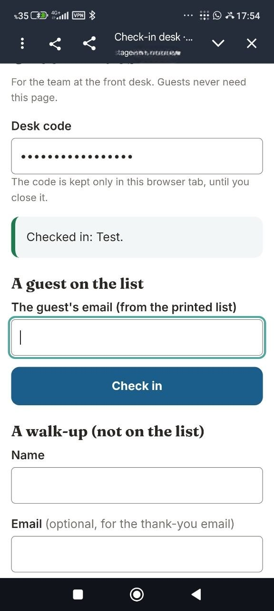 | 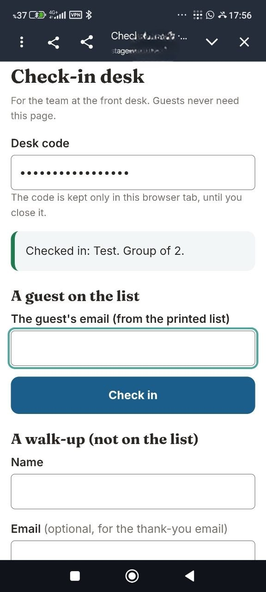 | 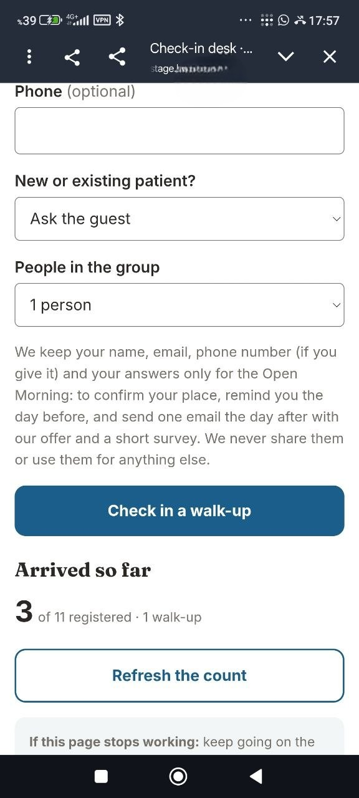 |