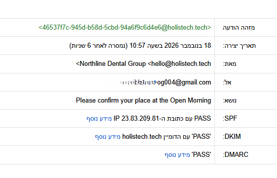
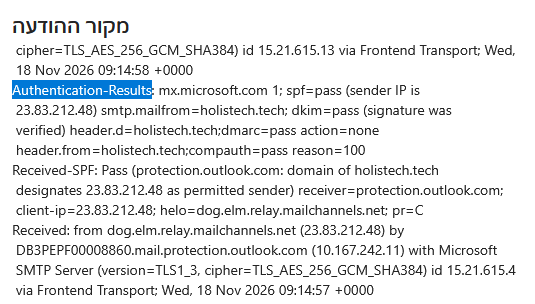
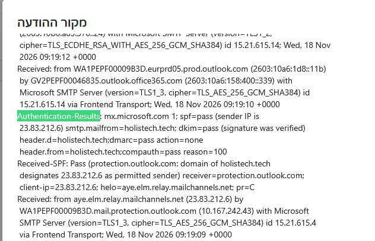
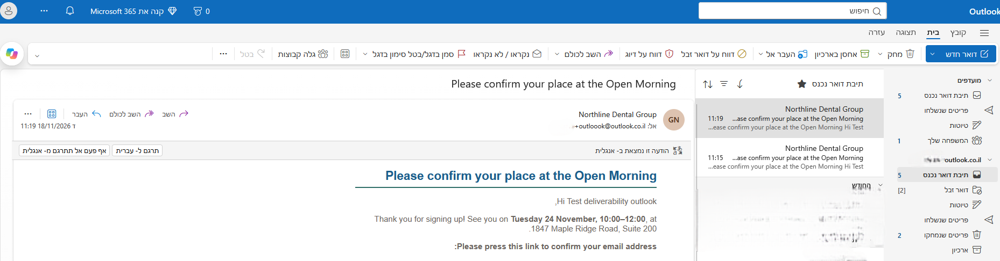

# Email check: confirmation, Wed 18 Nov

Task 35 ([#166](https://github.com/eitan-dardik/northline-dental-website/issues/166)). The Open Morning confirmation email (the "Confirmation" text in [EMAILS.md](https://github.com/eitan-dardik/northline-dental-website/blob/dev/docs/event/EMAILS.md), as Denise approved it), sent by my mailer on staging ([PR #187](https://github.com/eitan-dardik/northline-dental-website/pull/187)) through Hostinger's mail server, to two providers. Israel time unless marked UTC.

## The records (from dig, on the server)

- SPF: `v=spf1 include:_spf.mail.hostinger.com ~all`
- DKIM (selector `hostingermail-a`, from the `s=` of a received email): present (`hostingermail-a._domainkey.holistech.tech` points to Hostinger's key, `v=DKIM1; k=rsa; p=MIIB…`)
- DMARC: `v=DMARC1; p=none`

```
$ dig +short TXT holistech.tech | grep -i spf
"v=spf1 include:_spf.mail.hostinger.com ~all"
$ dig +short TXT _dmarc.holistech.tech
"v=DMARC1; p=none"
$ dig +short TXT hostingermail-a._domainkey.holistech.tech | cut -c1-80
hostingermail-a.dkim.mail.hostinger.com.
"v=DKIM1;k=rsa;p=MIIBIjANBgkqhkiG9w0BAQEFAAOCAQ8AMIIBCgKCAQEAs+RijpkYCOFcf5HdHXc
```

## Two inboxes

Each test is one registration on the staging page (PC, private window), so the mailer sent the real confirmation. "Sent" is when Hostinger's mail server accepted it (`sent_at`, and the mailer's log line `250 2.0.0 OK`).

| Inbox | Sent | Received | Inbox or spam | SPF | DKIM | DMARC |
|---|---|---|---|---|---|---|
| Gmail (`+og004`) | 10:57:04 | 10:57 ("delivered after 6 seconds") | Inbox | pass | pass | pass |
| Outlook.com (plain address) | 11:14:53 | 11:14:57 (Outlook's header 09:14:57 UTC) | Inbox | pass | pass | pass |
| Outlook.com (the same mailbox, a `+` address) | 10:59:05 | **11:19:09** (header 09:19:09 UTC) | Inbox | pass | pass | pass |

**Found:** Outlook held the first email from us for 20 minutes (no bounce, no error; our server accepted it at once, and the headers show it reached Microsoft through Hostinger's relay). The next one, 15 minutes later, took 4 seconds. Gmail took 6 seconds. So the 60-second target holds, except that a provider can hold the first email from a new sender. **For the invitations on Thursday:** send the first batch early in the window, and check Outlook and Gmail test addresses before the rest.



 



**p=none means:** the receiving server only reports a failed DMARC check to us; it still delivers the email, so a forged email from `holistech.tech` that fails DMARC can still reach the inbox. A stricter policy (`quarantine`, then `reject`) would stop it; that's a later change, after the event, once the reports show only our own mail passing.
