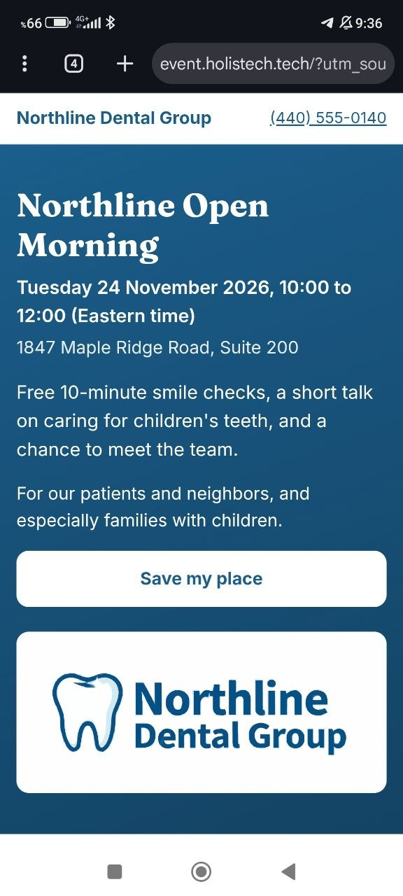
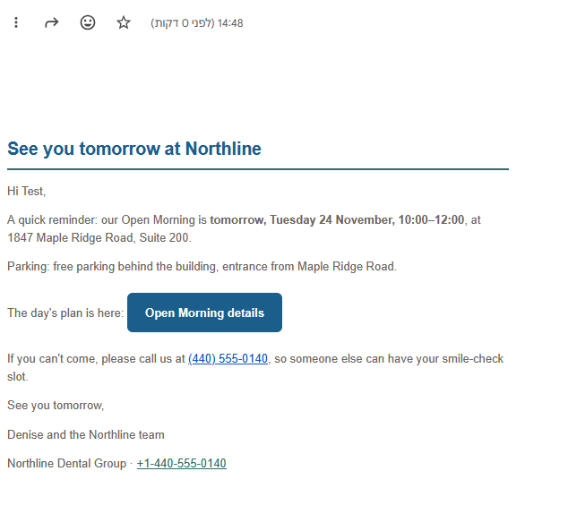

# Week 8 Evidence

Israel time unless marked UTC (the clinic is 7 hours behind). **Masking rule for every pack:** the domain and site addresses may show; mailbox names, the server login, keys, codes and tokens never do.

| # | Item | Proof |
|---|---|---|
| 1 | Reminders sent | Mon 23 Nov, **14:48:09** (7:48 clinic time, before 15:00): **1 sent, 0 bounced**; in the [run of show](https://github.com/eitan-dardik/northline-dental-website/blob/dev/docs/event/RUN-OF-SHOW.md) and on [#200](https://github.com/eitan-dardik/northline-dental-website/issues/200#issuecomment-7101764386); details: [see below](#row-1-reminders-sent) |
| 2 | Phone test | Mon 23 Nov, 15:03–15:18, mobile data: every link, the QR, confirm, check-in and the survey passed; [#201](https://github.com/eitan-dardik/northline-dental-website/issues/201#issuecomment-7102526024); the table and [img/51-phone-test-umami.png](img/51-phone-test-umami.png): [see below](#row-2-phone-test) |
| 3 | Go/no-go and freeze | [the go/no-go note](https://github.com/eitan-dardik/northline-dental-website/issues/114#issuecomment-7103072549) (GO, all eight rules pass) · [the freeze notice](https://github.com/eitan-dardik/northline-dental-website/issues/114#issuecomment-7103090834) (Mon 17:00 → Tue 19:00, live `57dd9a8`, revert steps); [img/53-live-deploy.png](img/53-live-deploy.png) |
| 4 | Run of show, filled in on the day | To do: finished Mon 23 by 23:59 (task 55, with Denise's answers from the 17:15 call); filled in on Tue 24: [RUN-OF-SHOW.md](https://github.com/eitan-dardik/northline-dental-website/blob/dev/docs/event/RUN-OF-SHOW.md) |
| 5 | Note to Denise | To do (Tue 24, 19:30) |
| 6 | Follow-ups with survey links, and promise log | To do (Wed 25, 16:00): PROMISES.md; the counts of `thank_you` and `missed_you` sent |
| 7 | Real numbers, the funnel report and what guests said | To do (Wed 25): REPORT.md, with the survey response rate |
| 8 | Registration closed, page archived, export sent | To do (Thu 26): the release; the refused test; the date sent |
| 9 | Retirement note | To do (Thu 26): RETIREMENT.md |
| 10 | Runbook section | To do (Thu 26): RUNBOOK.md |
| 11 | Retro | To do (Thu 26): retro.md |

**Moved from earlier weeks:**

| Task | Item | Proof |
|---|---|---|
| W6 task 14 | Contact form limits | To do: due Mon 23 Nov, 23:59 ([#128](https://github.com/eitan-dardik/northline-dental-website/issues/128)); the PR into `dev` with each rule's refused insert and its error code; #35 and #36 closed |
| W7 action 1 | Phone alarm for every check, before the event shift | [#184](https://github.com/eitan-dardik/northline-dental-website/issues/184): 12 alarms for Tue 24 Nov, 16:00–19:30, one per run-of-show time; tested in Do Not Disturb (Mon 23, 10:00) |
| W7 action 2 | Monitoring bot | To do: due Tue 24 Nov ([#182](https://github.com/eitan-dardik/northline-dental-website/issues/182)): built Tue morning, installed after the freeze (19:45–21:00) |

**Actual (h)** is filled in on every finished card on the [Open Morning board](https://github.com/users/eitan-dardik/projects/7).

## Row 1: reminders sent

**Task 50 ([#200](https://github.com/eitan-dardik/northline-dental-website/issues/200)).** EMAILS.md email 3 ("See you tomorrow at Northline"), word for word as Denise approved it (#114, Tue 17 Nov), with the `reminder` link from MEASURE.md. Sent by a one-off script, `remind.mjs`, run inside the production mailer's container (`docker exec`), so it uses the mailer's own sender and settings, like the invitations. It holds no personal data: it reads the recipients from the database, never from a file.

- **Who:** every registered guest of the event (not walk-ups), confirmed or not, once each.
- **Claim-first, like the mailer:** a `reminder` row in `registration_emails` is inserted before sending; the primary key stops a second send, even if the script runs twice. A failed send removes its claim, so it can be retried.
- **The log:** the registration id's first 8 characters and the mail server's reply, never a name or an address.

| Step | Time | Result |
|---|---|---|
| Dry run | before 09:35 | `1 registered, 0 already reminded, 1 to send` |
| Test reminder to my own `+og` address (no database row) | 09:35 | `done: 1 sent, 0 failed`; Inbox on my phone; the time, address, parking line and phone number right |
| "Open Morning details" pressed, phone on mobile data | 09:36 | the event page opened; Umami (production): 1 view, `utm_source=reminder` (a test visit, task 60) |
| **The send** | **14:48:09** | `sent: reminder 7f08e4a2: 250 2.0.0 OK` · `done: 1 sent, 0 failed, 0 skipped, of 1` |
| Arrived | 14:48 | `+og006`, Inbox: **0 bounced** |
| `registration_emails` | — | 1 row, `kind = reminder`, `sent_at` 12:48:09 UTC |

**Why only 1:** the invitations went to my own address with guest tags, and nobody registered from them, so the only registration on production was my `+og006` test from the release check (Thu 19 Nov). The same script sends to every registered guest, however many.

| The test reminder (09:35) | Its button: the event page (09:36) | The real send, arrived (14:48) |
|---|---|---|
|  |  |  |

## Row 2: phone test

**Task 51 ([#201](https://github.com/eitan-dardik/northline-dental-website/issues/201)).** Mon 23 Nov, 15:03–15:18: my phone (Xiaomi, Chrome), mobile data, Wi-Fi off; production (`event.holistech.tech`). A new test address for each registration.

| Link | Opens | UTM in Umami | Row read back | Email (min) |
|---|---|---|---|---|
| Invitation link (from an invitation in Gmail) | ✅ 15:03 | `invitation` | `+og2301`, 15:03:03, `invitation` | confirmation < 1 (3 s) |
| Reminder link (today's reminder) | ✅ 15:05 | `reminder` | `+og2302`, 15:05:02, `reminder` | < 1 (5 s) |
| Poster QR (`poster-qr.png` on the PC screen, phone camera → Google Lens → Chrome) | ✅ 15:10 | `poster` | `+2303`, 15:11:20, `poster` (typed without "og": still a test row) | < 1 |
| Website banner (northline.holistech.tech) | ✅ 15:12 | `website` | `+og2304`, 15:12:59, `website` | < 1 (11 s) |
| Check-in step (production desk code) | ✅ | — | `+og2301` arrived 15:15:42 | — |
| Confirm link (in `+og2301`'s confirmation) | ✅ 15:13 | `confirmation` | `verified_at` 15:13:53 | — |
| Survey link (`+og2301`'s token, query 9) | ✅ 15:17 | `thank-you` | answer stored 15:18 (`event_feedback`: 1) | — |

The read-back on the server (tags only, no addresses). First, by tag (`where r.email like '%+og23%'`):

```
   tag   | registered | utm_source | confirmation | verified | arrived
---------+------------+------------+--------------+----------+----------
 +og2301 | 15:03:03   | invitation | 15:03:06     | 15:13:53 | 15:15:42
 +og2302 | 15:05:02   | reminder   | 15:05:07     |          |
 +og2304 | 15:12:59   | website    | 15:13:10     |          |
(3 rows)
```

Then by time (`where created_at > now() - interval '1 hour'`):

```
   tag   | registered | utm_source
---------+------------+------------
 +og2301 | 15:03:03   | invitation
 +og2302 | 15:05:02   | reminder
 +2303   | 15:11:20   | poster
 +og2304 | 15:12:59   | website
(4 rows)
```

`event_feedback`: `count 1` (the survey answer, 15:18).

**Found:** the first read-back missed the poster row, because I typed its tag without "og". The second read-back, by time, found it; its confirmation arrived in Gmail at 15:11. Lesson for Wednesday's cleanup (task 60): find test rows by time as well as by tag.

**Test visits to take out on Wednesday (task 60):** 09:36 (the reminder test), 15:03–15:18 (the rows above); test registrations `+og006`, `+og2301`, `+og2302`, `+2303`, `+og2304`.

