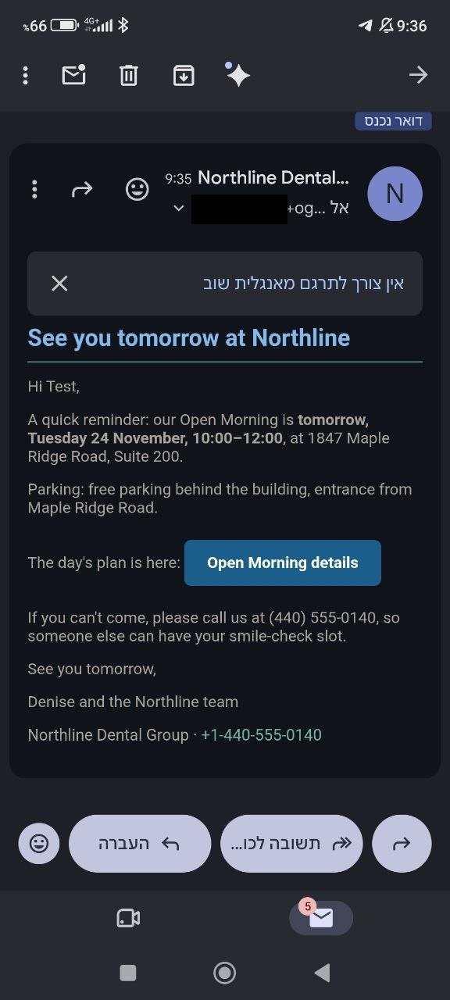
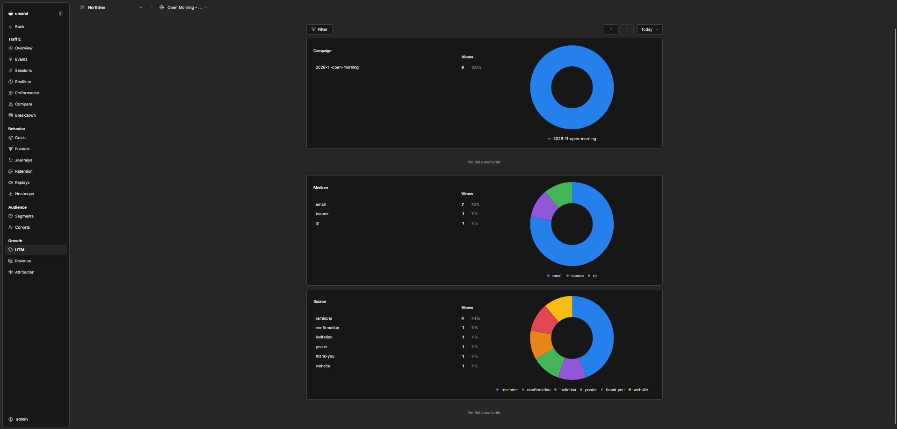
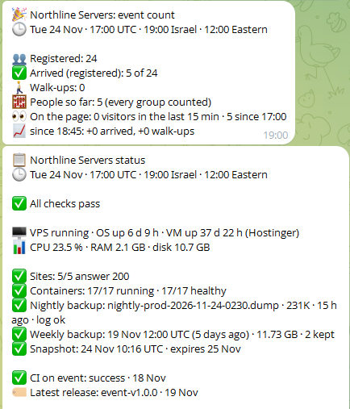
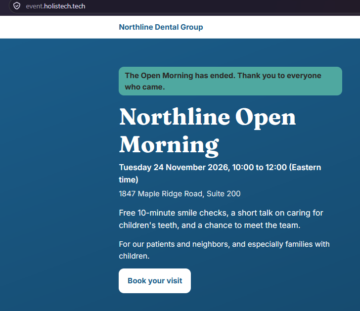
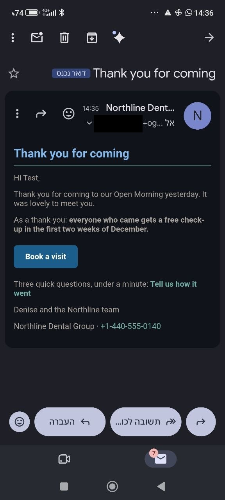
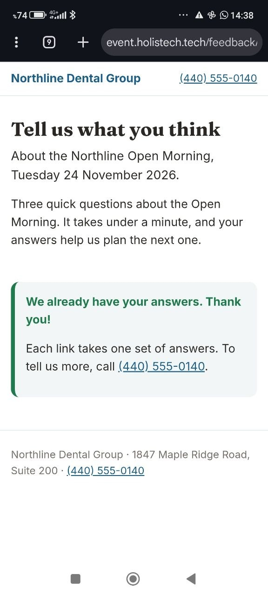
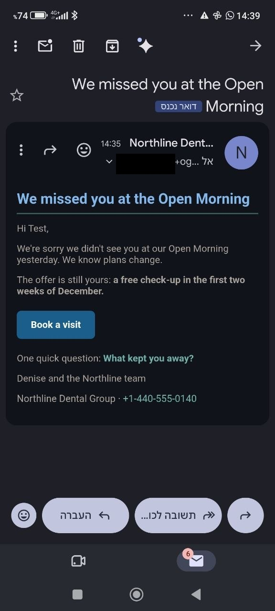
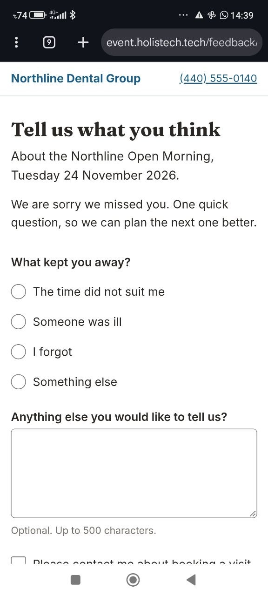
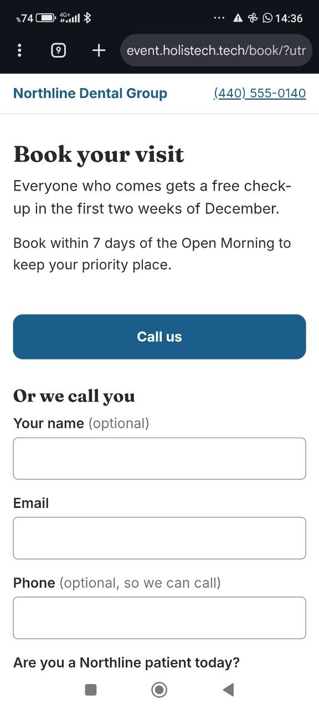
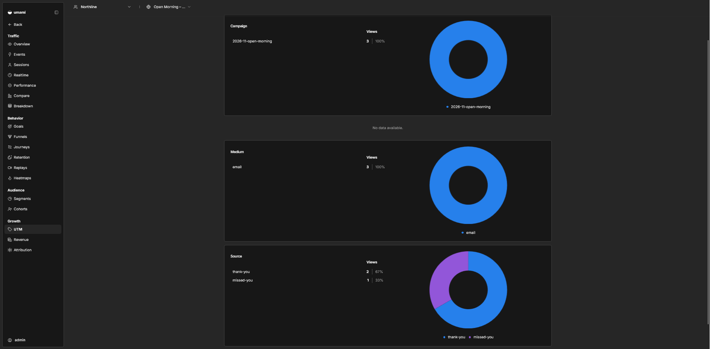

# Week 8 Evidence

Israel time unless marked UTC (the clinic is 7 hours behind). **Masking rule for every pack:** the domain and site addresses may show; mailbox names, the server login, keys, codes and tokens never do.

| # | Item | Proof |
|---|---|---|
| 1 | Reminders sent | Mon 23 Nov, **14:48:09** (7:48 clinic time, before 15:00): **1 sent, 0 bounced**; in the [run of show](https://github.com/eitan-dardik/northline-dental-website/blob/dev/docs/event/RUN-OF-SHOW.md) and on [#200](https://github.com/eitan-dardik/northline-dental-website/issues/200#issuecomment-7101764386); details: [see below](#row-1-reminders-sent) |
| 2 | Phone test | Mon 23 Nov, 15:03–15:18, mobile data: every link, the QR, confirm, check-in and the survey passed; [#201](https://github.com/eitan-dardik/northline-dental-website/issues/201#issuecomment-7102526024); the table and [img/51-phone-test-umami.png](img/51-phone-test-umami.png): [see below](#row-2-phone-test) |
| 3 | Go/no-go and freeze | [the go/no-go note](https://github.com/eitan-dardik/northline-dental-website/issues/114#issuecomment-7103072549) (GO, all eight rules pass) · [the freeze notice](https://github.com/eitan-dardik/northline-dental-website/issues/114#issuecomment-7103090834) (Mon 17:00 → Tue 19:00, live `57dd9a8`, revert steps); [img/53-live-deploy.png](img/53-live-deploy.png) |
| 4 | Run of show, filled in on the day | [RUN-OF-SHOW.md](https://github.com/eitan-dardik/northline-dental-website/blob/dev/docs/event/RUN-OF-SHOW.md): finished Mon 23 (task 55, [PR #219](https://github.com/eitan-dardik/northline-dental-website/pull/219)); filled in on Tue 24 ([PR #222](https://github.com/eitan-dardik/northline-dental-website/pull/222)): the final check (five lines, 16:29–16:35, task 56), a line every 15 minutes 17:00–19:00, and the five problems with heard / what I did / solved (task 57, [#207](https://github.com/eitan-dardik/northline-dental-website/issues/207)); details: [see below](#row-4-the-event) |
| 5 | Note to Denise | [the note on #114](https://github.com/eitan-dardik/northline-dental-website/issues/114#issuecomment-7138605472), posted before 19:30 (task 58, [#208](https://github.com/eitan-dardik/northline-dental-website/issues/208)) |
| 6 | Follow-ups with survey links, and promise log | In progress: the dry run and both tests done Wed 14:35 ([see below](#row-6-follow-ups)); the send at 16:00; PROMISES.md and the counts of `thank_you` and `missed_you` after it |
| 7 | Real numbers, the funnel report and what guests said | To do (Wed 25): REPORT.md, with the survey response rate |
| 8 | Registration closed, page archived, export sent | To do (Thu 26): the release; the refused test; the date sent |
| 9 | Retirement note | To do (Thu 26): RETIREMENT.md |
| 10 | Runbook section | To do (Thu 26): RUNBOOK.md |
| 11 | Retro | To do (Thu 26): retro.md |

**Moved from earlier weeks:**

| Task | Item | Proof |
|---|---|---|
| W6 task 14 | Contact form limits | To do (Thu 26 Nov, 23:59; moved from Mon 23 with a delay notice on [#128](https://github.com/eitan-dardik/northline-dental-website/issues/128), the servers were frozen): the PR into `dev` with each rule's refused insert and its error code; #35 and #36 closed |
| W7 action 1 | Phone alarm for every check, before the event shift | [#184](https://github.com/eitan-dardik/northline-dental-website/issues/184): 12 alarms for Tue 24 Nov, 16:00–19:30, one per run-of-show time; tested in Do Not Disturb (Mon 23, 10:00) |
| W7 action 2 | Monitoring bot | [#182](https://github.com/eitan-dardik/northline-dental-website/issues/182): running on the VPS since Tue 24, 13:35 (cron, every 5 minutes; alerts and the status message on Telegram, times in UTC, Israel and Eastern); the code in `dev` ([PR #220](https://github.com/eitan-dardik/northline-dental-website/pull/220), `ops/monitor/`). Every status during the event: all checks pass. An event-day helper for the 15-minute counts in its own PR, [#221](https://github.com/eitan-dardik/northline-dental-website/pull/221) (the CEO decides whether it's merged); its cron line removed at 19:04 |

**Actual (h)** is filled in on every finished card on the [Open Morning board](https://github.com/users/eitan-dardik/projects/7).

## Row 1: reminders sent

**Task 50 ([#200](https://github.com/eitan-dardik/northline-dental-website/issues/200)).** EMAILS.md email 3 ("See you tomorrow at Northline"), word for word as Denise approved it (#114, Tue 17 Nov), with the `reminder` link from MEASURE.md. Sent by a one-off script, `remind.mjs`, run inside the production mailer's container (`docker exec`), so it uses the mailer's own sender and settings, like the invitations. It holds no personal data: it reads the recipients from the database, never from a file.

- **Who:** every registered guest of the event (not walk-ups), confirmed or not, once each.
- **Claim-first, like the mailer:** a `reminder` row in `registration_emails` is inserted before sending; the primary key stops a second send, even if the script runs twice. A failed send removes its claim, so it can be retried.
- **The log:** the registration id's first 8 characters and the mail server's reply, never a name or an address.

| Step | Time | Result |
|---|---|---|
| Dry run | before 09:35 | `1 registered, 0 already reminded, 1 to send` |
| Test reminder to my own `+og` address (no database row) | 09:35 | `done: 1 sent, 0 failed`; Inbox on my phone; the time, address, parking line and phone number right |
| "Open Morning details" pressed, phone on mobile data | 09:36 | the event page opened; Umami (production): 1 view, `utm_source=reminder` (a test visit, task 60) |
| **The send** | **14:48:09** | `sent: reminder 7f08e4a2: 250 2.0.0 OK` · `done: 1 sent, 0 failed, 0 skipped, of 1` |
| Arrived | 14:48 | `+og006`, Inbox: **0 bounced** |
| `registration_emails` | — | 1 row, `kind = reminder`, `sent_at` 12:48:09 UTC |

**Why only 1:** the invitations went to my own address with guest tags, and nobody registered from them, so the only registration on production was my `+og006` test from the release check (Thu 19 Nov). The same script sends to every registered guest, however many.

| The test reminder (09:35) | Its button: the event page (09:36) | The real send, arrived (14:48) |
|---|---|---|
|  |  |  |

## Row 2: phone test

**Task 51 ([#201](https://github.com/eitan-dardik/northline-dental-website/issues/201)).** Mon 23 Nov, 15:03–15:18: my phone (Xiaomi, Chrome), mobile data, Wi-Fi off; production (`event.holistech.tech`). A new test address for each registration.

| Link | Opens | UTM in Umami | Row read back | Email (min) |
|---|---|---|---|---|
| Invitation link (from an invitation in Gmail) | ✅ 15:03 | `invitation` | `+og2301`, 15:03:03, `invitation` | confirmation < 1 (3 s) |
| Reminder link (today's reminder) | ✅ 15:05 | `reminder` | `+og2302`, 15:05:02, `reminder` | < 1 (5 s) |
| Poster QR (`poster-qr.png` on the PC screen, phone camera → Google Lens → Chrome) | ✅ 15:10 | `poster` | `+2303`, 15:11:20, `poster` (typed without "og": still a test row) | < 1 |
| Website banner (northline.holistech.tech) | ✅ 15:12 | `website` | `+og2304`, 15:12:59, `website` | < 1 (11 s) |
| Check-in step (production desk code) | ✅ | — | `+og2301` arrived 15:15:42 | — |
| Confirm link (in `+og2301`'s confirmation) | ✅ 15:13 | `confirmation` | `verified_at` 15:13:53 | — |
| Survey link (`+og2301`'s token, query 9) | ✅ 15:17 | `thank-you` | answer stored 15:18 (`event_feedback`: 1) | — |

The read-back on the server (tags only, no addresses). First, by tag (`where r.email like '%+og23%'`):

```
   tag   | registered | utm_source | confirmation | verified | arrived
---------+------------+------------+--------------+----------+----------
 +og2301 | 15:03:03   | invitation | 15:03:06     | 15:13:53 | 15:15:42
 +og2302 | 15:05:02   | reminder   | 15:05:07     |          |
 +og2304 | 15:12:59   | website    | 15:13:10     |          |
(3 rows)
```

Then by time (`where created_at > now() - interval '1 hour'`):

```
   tag   | registered | utm_source
---------+------------+------------
 +og2301 | 15:03:03   | invitation
 +og2302 | 15:05:02   | reminder
 +2303   | 15:11:20   | poster
 +og2304 | 15:12:59   | website
(4 rows)
```

`event_feedback`: `count 1` (the survey answer, 15:18).

**Found:** the first read-back missed the poster row, because I typed its tag without "og". The second read-back, by time, found it; its confirmation arrived in Gmail at 15:11. Lesson for Wednesday's cleanup (task 60): find test rows by time as well as by tag.

**Test visits to take out on Wednesday (task 60):** 09:36 (the reminder test), 15:03–15:18 (the rows above); test registrations `+og006`, `+og2301`, `+og2302`, `+2303`, `+og2304`.



## Row 4: the event

**Final check (task 56, [#206](https://github.com/eitan-dardik/northline-dental-website/issues/206#issuecomment-7134777786)):** the page on my phone on mobile data (16:29:58); a test registration (`+2401`, typed without "og") stored 16:31:15, confirmed 16:32 and checked in 16:35:09; one visitor in Umami with every step (16:29–16:35, test visits for task 60), then tracking off; today's backup `nightly-prod-2026-11-24-0230.dump`, 232K, log `ok`. Late registrations (16:00): 0 after Monday's list; Denise told [on #114](https://github.com/eitan-dardik/northline-dental-website/issues/114#issuecomment-7133652099) at 15:59. All five passed; the lines with times are in the run of show.

**The counts (task 57, [#207](https://github.com/eitan-dardik/northline-dental-website/issues/207#issuecomment-7138767090)).** From the event-count message on Telegram, every 15 minutes; my six test registrations are left out.

| Time | Registered | Check-ins (tablet) | Visitors on the page (last 15 min) | Servers |
|---|---|---|---|---|
| 17:00 | 24 | 0 | 0 | all checks pass |
| 17:15 | 24 | 5 | 5 | all checks pass |
| 17:30 | 24 | 5 | 0 | all checks pass |
| 17:45 | 24 | 5 | 0 | all checks pass |
| 18:00 | 24 | 5 | 0 | all checks pass |
| 18:15 | 24 | 5 | 0 | all checks pass |
| 18:30 | 24 | 5 | 0 | all checks pass |
| 18:45 | 24 | 5 | 0 | all checks pass |
| 19:00 | 24 | 5 | 0 (5 since 17:00) | all checks pass |

| The last count on Telegram (19:00) | The page at 19:00 |
|---|---|
|  |  |

**The tablet** has the first five check-ins (all at 17:05); no other sign-up arrived after that. When it got busy, Maria put the walk-ins on paper (Denise, #114, Tue evening). Umami's events on the check-in page show no activity 17:18–18:33 and no form errors, so it wasn't a page fault. **From Denise's paper list: 5 people:** the two neighbours (2), the guest with the email typo (1, a sign-up), the dad and son (2). **10 people came: 6 of the 24 sign-ups and 4 walk-ups in 2 groups.** The funnel report (row 7) starts from these numbers.

**Problems (heard → solved):** 16:33 → 16:35 (my test check-in: a typo in my own test address); 17:21 → 17:21 ([two walk-ins](https://github.com/eitan-dardik/northline-dental-website/issues/114#issuecomment-7135899651)); 17:35 → by 18:00 ([a guest with no emails](https://github.com/eitan-dardik/northline-dental-website/issues/114#issuecomment-7136271413): a typo in her address, [my answer](https://github.com/eitan-dardik/northline-dental-website/issues/114#issuecomment-7137164141); the right address confirmed by Denise on Telegram); 18:15 → 18:33 (walk-ups not in the database: the walk-ins on paper); 18:25 → 18:28 ([a dad and son](https://github.com/eitan-dardik/northline-dental-website/issues/114#issuecomment-7137715436)). Each with what I did, in the run of show. Nothing broke on the servers; no revert, nothing changed during the freeze.

**After the freeze (19:14):** the guest with the typo: her address corrected and her registration marked arrived (18:00), in one transaction, dry run first (`ROLLBACK`), then `COMMIT` (`UPDATE 1`) and a read-back; the address confirmed by Denise (Telegram), the time from the CEO (Telegram). So she gets the thank-you on Wednesday, and she's counted once. Check-ins on the system: 6.

## Row 6: follow-ups

**Task 59 ([#209](https://github.com/eitan-dardik/northline-dental-website/issues/209)).** EMAILS.md emails 4 ("Thank you for coming") and 5 ("We missed you at the Open Morning"), word for word as Denise approved them, with the offer she confirmed (#114, Mon 23): a free check-up in the first two weeks of December. Sent by a one-off script, `followup.mjs`, run inside the production mailer's container like `remind.mjs`: the same sender and settings, claim-first on `registration_emails` (`thank_you` or `missed_you`; the primary key stops a second send), my test registrations left out, and a log with the registration id's first 8 characters and the mail server's reply only (never a name, an address or a token).

- **Who gets which (query 9):** signed up and checked in → the thank-you; signed up and not checked in → "sorry we missed you". Walk-ups gave no email, so they get none.
- **Each guest's own survey link:** `feedback/?t=<token>` (with `&k=missed` for "missed you"), and **Book a visit** → `book/`; both tagged `utm_source=thank-you` or `missed-you`, `utm_medium=email`, `utm_campaign=2026-11-open-morning`.

| Step | Time | Result |
|---|---|---|
| Dry run | 14:3x | `30 registered, 6 test rows skipped, 24 guests (6 came, 18 missed), 0 already sent; to send: 6 thank_you, 18 missed_you` |
| Test thank-you, to my test registration `+og2301` (checked in), with its own token; no database row | 14:35:16 | `250 2.0.0 OK` · `done: 1 sent, 0 failed, of 1` |
| Test "missed you", to `+og2302` (not checked in) | 14:35:17 | `250 2.0.0 OK` · `done: 1 sent, 0 failed, of 1` |
| Both on my phone, mobile data | 14:36–14:39 | the texts as approved; **Book a visit** opens `book/` with its tags; the thank-you survey answered "We already have your answers" (`+og2301` answered it in the phone test, Mon 15:18: one answer per guest holds on production); the "missed you" survey shows only "What kept you away?" |
| Umami (production), UTM | 14:4x | source `thank-you` 2 views (booking + survey), `missed-you` 1; medium `email`; campaign `2026-11-open-morning` |
| **The send** | 16:00 | to come |
| `registration_emails`, read back | | to come |

| The thank-you (test) | Its survey: one answer per guest | "Missed you" (test) | Its survey: one question |
|---|---|---|---|
|  |  |  |  |

| Book a visit | Umami: the two sources |
|---|---|
|  |  |

